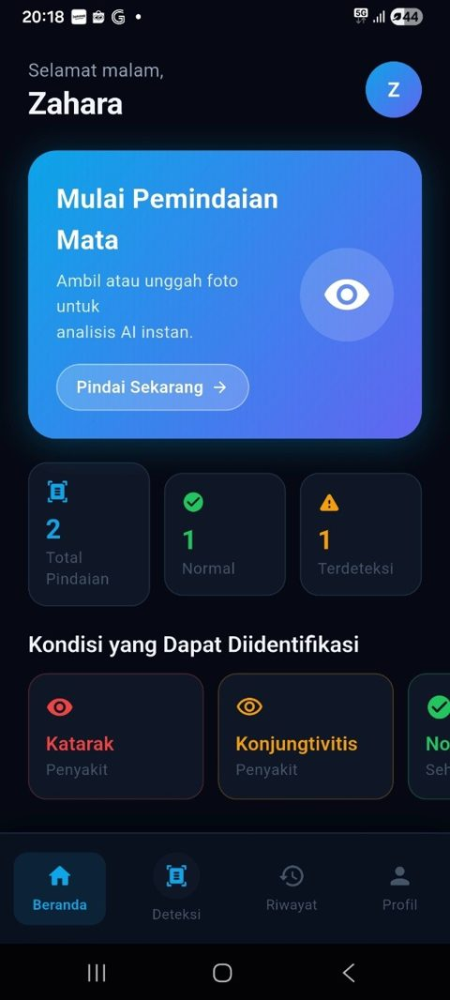

# Portofolio Statis (HTML + CSS)

Website satu halaman tanpa framework dan tanpa build. Semua konten ada di `index.html`, tampilan di `style.css`, gambar di `assets/`.

## Struktur folder

```
portfolio-site/
├── index.html     <- isi konten (teks, link, urutan section)
├── style.css      <- warna, font, layout
├── assets/        <- screenshot dan foto
└── README.md      <- dokumen ini
```

## Menjalankan di komputer

Klik dua kali `index.html`, atau di VS Code pakai ekstensi **Live Server** supaya otomatis refresh saat file disimpan. Butuh internet hanya untuk memuat font Google Fonts.

## Peta isi `index.html`

Setiap bagian diberi penanda komentar `<!-- ===== NAMA ===== -->`. Cari dengan Ctrl+F.

| Penanda | Isi |
|---|---|
| HERO | Headline, deskripsi singkat, tombol, mockup HP |
| PROYEK 1: ARETINA | Project mobile (3 mockup HP) |
| PROYEK 2: DAUN ANGGUR | Project web (mockup browser + timeline CRISP-DM) |
| PROYEK 3: CURAPURE | Kartu "In Progress" + alur pipeline |
| KEAHLIAN | Kartu skill |
| TENTANG SAYA | Foto dan paragraf pribadi |
| KONTAK | Email, CV, media sosial |

---

## CRUD konten

Karena ini situs statis (tanpa database), "CRUD" dilakukan dengan mengedit file lalu menyimpan. Hasilnya langsung terlihat setelah refresh.

### READ (cari dan baca data)

- Teks project: cari nama project (misal `Aretina`) di `index.html`.
- Warna dan font: lihat bagian `:root` paling atas di `style.css`.
- Placeholder yang belum diisi: cari `Nama Kamu`, `email@kamu.com`, `xx`, dan `href="#"`.

### UPDATE (ubah data)

**Ubah teks**: edit langsung di antara tag, misalnya `<p>...</p>`.

**Ubah link**: ganti `href="#"` dengan URL asli.
```html
<div class="links"><a href="https://github.com/username/aretina">GitHub</a></div>
```

**Ganti gambar**: taruh file baru di `assets/`, lalu ubah `src`.
```html

```
Tips: pakai ukuran screenshot yang sama (rasio sekitar 9:20) dan kompres dulu (lebar 480 sampai 600 px) supaya halaman cepat dibuka.

**Isi screenshot Streamlit**: ganti blok ini
```html
<div class="shot">Tempatkan tangkapan layar ...</div>
```
dengan
```html

```

**Update status CuraPure saat selesai**:
1. Ubah `<span class="badge">In Progress</span>` menjadi `Completed`.
2. Ubah eyebrow `Sedang dikerjakan · Mobile + Backend` menjadi `Project · Mobile + Backend`.
3. Isi ulang `<div class="status">...</div>` atau hapus.
4. Opsional: tambahkan mockup HP seperti di bagian Aretina.

**Ubah warna**: edit variabel di `style.css`.
```css
:root{
  --bg:#FFF9F7;     /* latar */
  --ink:#2D2433;    /* warna teks */
  --g1:#F4B7A3; --g2:#E8A2B9; --g3:#B9A5E8; --g4:#9FB8F2; /* gradasi */
}
```

### CREATE (tambah data)

**Tambah project baru**
1. Salin satu blok `<section id="aretina"> ... </section>` (dari penanda sampai `</section>`).
2. Tempel di bawah project terakhir, ubah `id` (misal `id="proyek4"`).
3. Ganti judul, tagline, Masalah/Solusi/Hasil, chip teknologi, link, dan gambar.
4. Tambahkan menu di navbar: `<li><a href="#proyek4">Nama Proyek</a></li>`.

Untuk membalik posisi teks dan gambar (zig-zag), tukar urutan dua `<div>` di dalam `.wrap.proj`.

**Tambah chip teknologi**
```html
<div class="chips"><span>Flutter</span><span>Firebase</span></div>
```

**Tambah kartu keahlian** (di dalam `<div class="sk">`)
```html
<div>
  <h3>Nama Kemampuan</h3>
  <p>Penjelasan singkat apa yang bisa dikerjakan.</p>
  <small>Tool A · Tool B</small>
  <small class="u">Dipakai di: Nama Project</small>
</div>
```

**Tambah tautan sosial**: di bagian KONTAK, tambah `<a href="URL">Nama</a>` dalam `<div class="soc">`.

### DELETE (hapus data)

- Hapus project: hapus satu blok `<section>` penuh (dari penanda sampai `</section>`), lalu hapus menu navbarnya.
- Hapus gambar: hapus tag `` yang memakainya, lalu hapus file di `assets/` jika tidak dipakai lagi.
- Hapus kartu keahlian atau chip: hapus satu `<div>` atau `<span>` terkait.
- Pastikan tag penutup tidak ada yang tertinggal.

---

## Deploy gratis

**Netlify**: buka netlify.com, login, pilih drag and drop, tarik seluruh folder `portfolio-site`. Link langsung aktif dan bisa diganti namanya di Site settings.

**GitHub Pages**: buat repo, upload isi folder (`index.html` harus di root repo), lalu Settings, Pages, pilih branch `main`.

Setiap kali ada perubahan: simpan file, upload ulang (Netlify drag and drop) atau `git push` (GitHub Pages).

## Checklist sebelum publikasi

- [ ] Ganti `Nama Kamu` (navbar, footer) dengan nama asli
- [ ] Isi email, GitHub, LinkedIn, Instagram, dan link CV
- [ ] Isi link APK, video demo, dan demo Streamlit
- [ ] Isi angka `xx` pada project daun anggur (jumlah gambar, mAP, jumlah kelas)
- [ ] Tambahkan screenshot Streamlit, foto, dan paragraf Tentang Saya
- [ ] Tulis status terkini CuraPure
- [ ] Buka di HP untuk memastikan tampilan responsif

## Jika nanti ingin CRUD lewat dashboard (opsional)

Pengelolaan lewat file seperti di atas sudah cukup untuk 3 sampai 10 project. Jika ingin menambah project lewat halaman admin dengan form, dibutuhkan backend dan database. Ini bisa jadi project belajar Go: simpan data project di JSON atau SQLite, tampilkan lewat `html/template`, dan buat endpoint tambah, ubah, hapus. Struktur HTML dan CSS di sini bisa dipakai ulang sebagai template.

## Animasi

Semua animasi ada di bagian paling bawah `style.css` (`/* ===== ANIMASI ===== */`) dan satu skrip kecil di akhir `index.html`.

- **Muncul saat di-scroll**: elemen naik dan memudar masuk bergantian. Ubah kecepatan di `.js .rv` (`.9s`), jeda antar elemen di skrip (`*0.1`).
- **Mockup HP melayang pelan**: atur di `@keyframes bob` (`-12px` jaraknya, `6s` durasinya di `.phone`).
- **Kilau di layar HP**: atur di `@keyframes glint`. Hapus aturan `.phone::after` jika tidak ingin.
- **Gradasi pada teks bergeser pelan**: atur di `.gt` dan `@keyframes shine`.
- **Mockup browser** masuk dengan efek miring yang lurus saat terlihat.
- Pengguna yang mengaktifkan "reduce motion" di perangkatnya otomatis tidak melihat animasi.

Untuk mematikan semua animasi, hapus blok ANIMASI di `style.css` dan skrip di akhir `index.html`.
